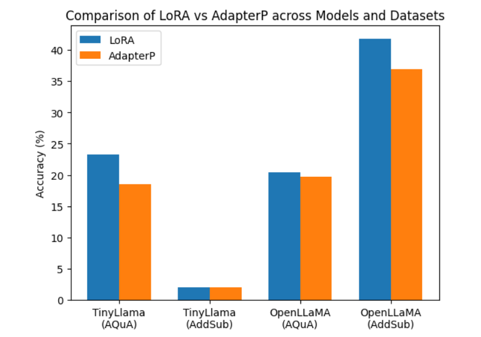

# Parameter-Efficient Fine-Tuning of LLMs for Math Reasoning

Comparing **LoRA** and **AdapterP** for fine-tuning two open-source LLMs (**TinyLlama-1.1B** and **OpenLLaMA-3B**) on mathematical word problems, evaluated on the **AQuA** and **AddSub** benchmarks. All experiments ran on a single GPU on NTU's SLURM cluster.

> Course project for **AI6130: Deep Learning for Natural Language Processing**, MSc Artificial Intelligence, Nanyang Technological University (2026).

**Highlights**
- Ran **7 fine-tuning configurations** across 2 models, 2 PEFT methods, 3 epoch settings and 2 training sets.
- **LoRA beat AdapterP** on every model and benchmark (or tied it).
- Training on **math_10k instead of math_7k raised AddSub accuracy from 41.77% to 68.61%** (OpenLLaMA-3B + LoRA). More data helped far more than more epochs.

---

## Results

### Main experiments (math_7k, 1 epoch)

| Model | Adapter | AQuA Acc. (%) | AddSub Acc. (%) |
|---|---|---|---|
| TinyLlama-1.1B | LoRA | **23.23** | 2.03 |
| TinyLlama-1.1B | AdapterP | 18.50 | 2.03 |
| OpenLLaMA-3B | LoRA | 20.47 | **41.77** |
| OpenLLaMA-3B | AdapterP | 19.69 | 36.96 |

<p align="center"></p>

### Optional experiments (OpenLLaMA-3B + LoRA)

**Effect of training epochs (math_7k)**

| Epochs | AQuA Acc. (%) | AddSub Acc. (%) |
|---|---|---|
| 1 | **20.47** | **41.77** |
| 2 | 16.14 | 38.48 |
| 3 | 16.14 | 40.25 |

**Effect of dataset size (1 epoch)**

| Fine-tuning set | AQuA Acc. (%) | AddSub Acc. (%) |
|---|---|---|
| math_7k | **20.47** | 41.77 |
| math_10k | 19.29 | **68.61** |

All numbers are also in [`results/results.csv`](results/results.csv).

---

## Key findings

1. **Model size matters most for arithmetic.** OpenLLaMA-3B reaches about 37–42% on AddSub while TinyLlama-1.1B stays near 2%. Part of TinyLlama's gap may come from answers in a format the evaluator's number-matching regex can't read.
2. **AQuA stays close to random.** AQuA has 5 answer choices, so guessing scores about 20%. Every configuration landed between 16% and 23%, so algebraic multiple-choice reasoning needs more targeted training than more data or more epochs.
3. **LoRA beats AdapterP.** LoRA adapts the attention projections and trains fewer parameters, which may suit numerical reasoning better and reduce overfitting on a small dataset.
4. **More epochs hurt, more data helped.** Training for 2–3 epochs on math_7k lowered accuracy, which suggests overfitting. Switching to math_10k for one epoch improved AddSub by about 27 points.

The full analysis is in the [report (PDF)](report/PEFT_Math_Reasoning_Report.pdf).

---

## Setup

| | |
|---|---|
| **Models** | `TinyLlama/TinyLlama_v1.1`, `openlm-research/open_llama_3b_v2` |
| **LoRA** | r = 8, α = 16, dropout = 0.05 |
| **AdapterP** | Pfeiffer-style bottleneck adapter, size 256, tanh |
| **Training** | 1 epoch, lr 3e-4, batch 4, cutoff 256 tokens, AdamW, 120 validation samples |
| **Benchmarks** | AQuA (254 multiple-choice questions, letter exact match), AddSub (395 arithmetic problems, numeric match) |
| **Hardware** | 1 NVIDIA GPU, NTU GPU cluster (SLURM, MGPU-TC2), 16 GB RAM; also Google Colab |

---

## How to run

The training and evaluation code (`finetune.py`, `evaluate.py`, adapter implementations) comes from the [course codebase](https://github.com/duyngtr16061999/AI6130_Assignment2), which is based on [LLM-Adapters](https://github.com/AGI-Edgerunners/LLM-Adapters). `run_experiment.py` clones it automatically and runs any experiment with one command.

```bash
git clone https://github.com/<your-username>/llm-peft-math-reasoning.git
cd llm-peft-math-reasoning

# First run: install pinned packages, then train + evaluate
python run_experiment.py --model openllama-3b --adapter lora --install
```

**Reproduce every experiment**

| Experiment | Command |
|---|---|
| 1 & 2: TinyLlama + LoRA | `python run_experiment.py --model tinyllama --adapter lora` |
| 3 & 4: TinyLlama + AdapterP | `python run_experiment.py --model tinyllama --adapter adapterp` |
| 5 & 6: OpenLLaMA-3B + LoRA | `python run_experiment.py --model openllama-3b --adapter lora` |
| 7 & 8: OpenLLaMA-3B + AdapterP | `python run_experiment.py --model openllama-3b --adapter adapterp` |
| Epochs = 2 / 3 | `python run_experiment.py --model openllama-3b --adapter lora --epochs 3` |
| math_10k | `python run_experiment.py --model openllama-3b --adapter lora --data math_10k` |

**On a SLURM cluster**

```bash
sbatch slurm/run_experiment.sh --model openllama-3b --adapter lora --data math_10k
```

Other useful flags: `--eval AQuA AddSub SVAMP gsm8k` (choose benchmarks), `--skip_train` (evaluate existing weights only), `--dry_run` (print commands without running them).

---

## Repository structure

```
llm-peft-math-reasoning/
├── run_experiment.py          # one-command fine-tune + evaluate for any configuration
├── slurm/run_experiment.sh    # SLURM batch job for GPU clusters
├── results/
│   ├── results.csv            # all accuracy numbers
│   └── lora_vs_adapterp.png   # main comparison chart
├── report/
│   └── PEFT_Math_Reasoning_Report.pdf
├── requirements.txt
└── .gitignore
```

---

## References

- Hu et al. (2021). *LoRA: Low-Rank Adaptation of Large Language Models.* arXiv:2106.09685
- Pfeiffer et al. (2020). *MAD-X: An Adapter-Based Framework for Multi-Task Cross-Lingual Transfer.* arXiv:2005.00052
- Hu et al. (2023). *LLM-Adapters: An Adapter Family for Parameter-Efficient Fine-Tuning of Large Language Models.* EMNLP 2023
- Ling et al. (2017). *Program Induction by Rationale Generation (AQuA).* ACL 2017
- Hosseini et al. (2014). *Learning to Solve Arithmetic Word Problems with Verb Categorization (AddSub).* EMNLP 2014

## Author

**Veluchamy Punitha**, MSc Artificial Intelligence, NTU Singapore
